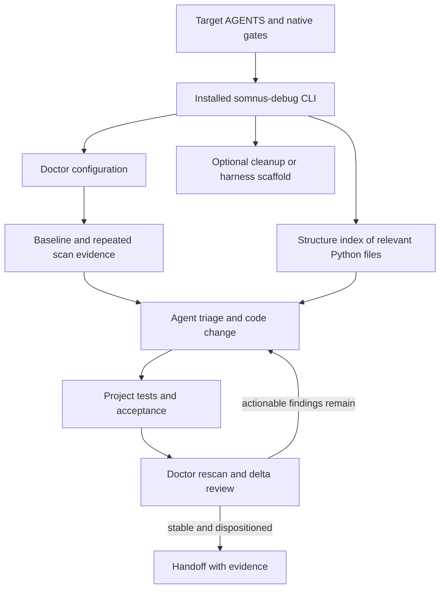

# Toolkit topology

**Domain:** using `somnus-debug` as a project-agnostic Python developer toolkit from inside a separate codebase.

## Load-bearing concepts

### LBC 1 — The command is a dispatcher

`somnus-debug` dispatches to independent tools: `doctor`, `structure`, `pycache-clean`, and `init-test-harness`. Each command owns its own parser and flags. Ask that command's `--help`; do not assume every flag belongs to the top-level CLI.

### LBC 2 — Doctor findings are static-analysis evidence

The doctor parses Python source and checks configured patterns for issues such as stubs, placeholder returns, exception handling, cycles, missing documentation or hints, TODOs, security-risk patterns, and test gaps. It does not execute the target code. Its findings need human/agent interpretation and project-native validation.

### LBC 3 — Include patterns define what exists to the scan

The current doctor config scans only files matching `include_patterns`, then removes matches in `ignore_patterns`. The shipped include globs are not universal. Scanning zero files says nothing about code health.

### LBC 4 — Structure is a per-file AST index

`structure` reports classes, nested classes, functions, methods, signatures, decorators, doc summaries, and line spans for a single Python file. It neither imports nor executes the file. It is useful for orientation and change-impact review, not a whole-repository semantic graph.

### LBC 5 — Some commands mutate the target filesystem

`pycache-clean` deletes `__pycache__`, `.pyc`, and `.pyo` targets according to YAML roots and filters. `init-test-harness` writes `run_test.py` and usually `CONTRACT.md`. Treat these as explicit actions with dry-run/overwrite protections.

### LBC 6 — Doctor state is local and conditional

Stateful doctor scans create SQLite state under `.python_doctor/`, enabling `history` and `rollback`. A weak-locking filesystem may cause a warning and stateless continuation. `--no-state` is for deliberate disposable scans; it removes history for that run.

### LBC 7 — The harness is a separate contract

The scaffolded one-test surface defines artifact semantics and acceptance for one project-owned test. It does not decide the project gate, own Accelerate, or require pytest. Use it only when the target repository wants that contract.

## Interface map

| Surface | Receives | Produces / changes | Boundary |
|---|---|---|---|
| `doctor scan` | Project root + doctor YAML + optional output paths | Markdown/JSON findings; `.python_doctor/` state unless `--no-state` | Python diagnostics, not full correctness proof |
| `doctor history` | Root/config + limit | Prior run summaries from local SQLite | Requires usable stored state |
| `doctor rollback` | Root/config + run ID | Restores an earlier report as latest | Does not revert source code |
| `doctor self-check` | Installed toolkit | Doctor's self-check scan and report | Checks doctor behavior against its own package |
| `structure` | One `.py` file | Definition index to stdout or file | AST only; one file at a time |
| `pycache-clean` | YAML roots/targets/excludes + dry-run choice | Dry-run plan or cache deletion | Destructive when live |
| `init-test-harness` | Target directory + overwrite flags | Project-owned `run_test.py`, optionally `CONTRACT.md` | Refuses overwrite unless `--force` |

## Dependency and flow map

## Complexity distribution

| Surface | Density | Slow down because |
|---|---|---|
| Doctor config and coverage | DENSE | Incorrect include patterns can produce a convincing empty scan. |
| Finding triage | DENSE | Heuristics can be false positives; blindly fixing them can cause scope creep or regressions. |
| Doctor history/rollback | MEDIUM | State depends on local SQLite; rollback concerns reports, not source. |
| Structure index | MEDIUM | Useful for local architecture, easy to overstate as whole-repo graphing. |
| Pycache cleanup | DENSE | A live pass deletes files and roots are controlled by YAML. |
| Harness scaffold | MEDIUM | It writes a contract surface and protects existing hand-edited files. |

## Anti-concepts

| Looks like | Actual boundary |
|---|---|
| A clean doctor exit | The configured severity gate passed; other correctness gates remain. |
| `doctor` dependency-cycle results | Selected import/cycle diagnostics, not a complete code graph. |
| `structure` output | A single-file AST index, not runtime call behavior or repository-wide architecture. |
| `doctor rollback` | Report-history restoration, not a source-control rollback. |
| `init-test-harness` | Optional project-owned test scaffold, not a required Accelerate installation. |
| A config that includes no files | Invalid coverage for the current task, not a passing scan. |

## Entry vectors

- **Cold repo:** read target instructions → check CLI/version → inspect existing config and native gates → configure actual Python paths → baseline scan.
- **Python implementation task:** read doctor loop → inspect the touched file with `structure` → implement → run native validation → rescan and repeat.
- **Cleanup request:** read command safety in `commands.md` → inspect roots/exclusions → dry-run → obtain authority for live cleanup → run and verify.
- **Harness request:** inspect existing tests and acceptance → read `CONTRACT.md` summary in `commands.md` → scaffold only if the repo wants it.
- **Accelerate repo:** read `accelerate-integration.md` and place findings/artifacts in the active packet's existing evidence flow.
- **Version discrepancy:** check `provenance.md` and live upstream files; installed CLI behavior wins for flags.
