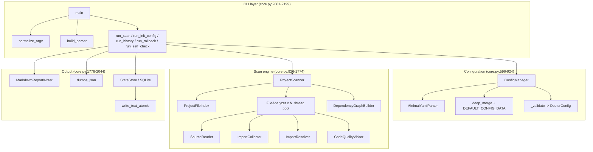
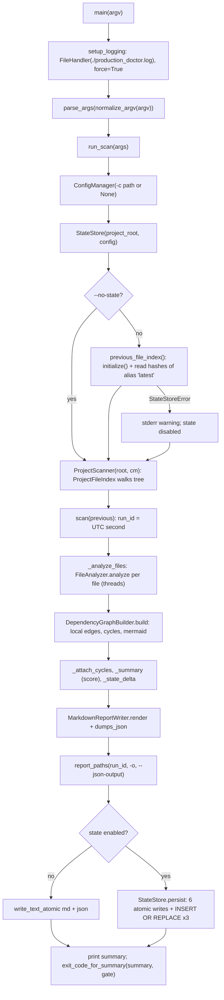

# Architecture

This page describes how `somnus-debug` is put together: the dispatcher, the four tools, and the internal layers of the doctor, which is where almost all of the logic lives. Line references are to baseline `034f46e`.

## Package shape

This section shows the static layout and which parts are code, data, or both.

```
src/somnus_debug/
  __init__.py            __version__ = "0.1.0"; __all__ = ["__version__"]
  cli.py                 somnus-debug router
  doctor/
    __init__.py          re-exports main
    core.py              the whole doctor (config, scan, graph, reports, state, CLI)
    default_config.yaml  reference copy of init-config output; read by no runtime code
  structure/
    __init__.py          re-exports build_index, main
    core.py              AST class/definition indexer
  pycache_cleaner/
    __init__.py          re-exports main
    core.py              config-driven bytecode cleaner (PyYAML)
  test_harness/
    __init__.py          metadata header only
    scaffold.py          copies templates into a target dir
    templates/
      __init__.py        makes templates a resource package
      run_test.py        harness template, read as text, never imported
      CONTRACT.md        harness contract, read as text
```

[SOURCE-CONFIRMED] file tree; [VERIFIED] wheel contents via `pip show -f` in [lane-a architecture §1](../_evidence/agent-findings/lane-a-arch-api/architecture.md). `default_config.yaml` is read only by `tests/test_cli_smoke.py:112` (a parity test), never at runtime. [SOURCE-CONFIRMED] grep; [lane-b configuration-findings §2.2](../_evidence/agent-findings/lane-b-config/configuration-findings.md).

## Dispatcher layer

This section explains how one console command reaches four tools with different calling conventions.

`cli.main(argv)` handles `-h/--help`, `-V/--version`, and unknown commands itself, then calls `_run_subcommand(name, rest)`. That function saves `sys.argv`, sets it to `[prog, *rest]`, calls the tool, and restores `sys.argv` in a `finally` block. Three tools take `argv` explicitly; `pycache_cleaner.core.main()` takes no argument and parses `sys.argv` itself, so it is called with no arguments (`src/somnus_debug/cli.py:100`). [SOURCE-CONFIRMED] `src/somnus_debug/cli.py:85-125`; [VERIFIED] in-process run restores `sys.argv`, [lane-a api-reference §5](../_evidence/agent-findings/lane-a-arch-api/api-reference.md).

Result mapping: an `int` return passes through; a non-int return (pycache's `None`) becomes 0; `SystemExit(int)` becomes that int; `SystemExit` with a non-int code becomes 1. Any other exception is not caught and surfaces as a traceback (interpreter exit 1). [SOURCE-CONFIRMED] `src/somnus_debug/cli.py:99-104`; [VERIFIED] [lane-d exit-codes](../_evidence/agent-findings/lane-d-cli-tests/exit-codes.md) (P06, P07).

## Doctor layers

This section breaks `doctor/core.py` into the layers it is actually organized in, top to bottom.



| Layer | Lines | Holds | Talks to |
|---|---|---|---|
| Types and errors | `src/somnus_debug/doctor/core.py:75-450` | type aliases, `Severity`, `DoctorError` family, 15 frozen dataclasses | everything |
| Defaults and rule data | `:451-523` | `DEFAULT_CONFIG_DATA`, `TODO_PATTERNS`, `PLACEHOLDER_CONSTANTS`, `SECURITY_CALLS`, report CSS | configuration, visitor |
| Utilities | `:525-595` | UTC time, hashing, JSON conversion, path and table escaping | all layers |
| Configuration | `:596-924` | YAML subset parser, merge, validators, `ConfigManager` | scan engine (read-only `DoctorConfig`) |
| Scan engine | `:926-1774` | file index, import resolution, per-file analyzer, AST detectors, dependency graph, scanner | configuration |
| Output | `:1776-2044` | Markdown writer, SQLite `StateStore`, atomic writes, history rendering, exit gate | file system |
| CLI | `:2046-2199` | `run_*` command functions, parser, argv normalization, logging, `main` | every layer |

[SOURCE-CONFIRMED] line ranges from the `def`/`class` index of `src/somnus_debug/doctor/core.py`.

The layering is clean in one direction: the scan engine and output layers never import or call the CLI layer, and nothing below the CLI layer logs or prints. That is why `ProjectScanner` can be embedded without side effects ([D-12](../DISCOVERY-LEDGER.md#d-12)). [VERIFIED] `/tmp/w1/ex_api.py` saw no new files in the cwd and no root handlers after a full scan.

## Doctor scan pipeline

This section shows the data flow of one `doctor scan`, from configuration to exit code.



[SOURCE-CONFIRMED] `src/somnus_debug/doctor/core.py:2061-2093`, `:1705-1714`, `:2179-2186`. Each step is expanded with line numbers in [call-chains](../07-internals/call-chains.md).

## Per-file analysis

This section shows what happens to a single file inside the scan, because this is where every finding originates.

```
FileAnalyzer.analyze()                       core.py:1520
  SourceReader.read (tokenize.open)          -> FileReadError -> analysis_read_errors, stop
  _token_diagnostics                         todos, tokenization_errors
  ast.parse                                  -> SyntaxError/ValueError -> syntax_errors, stop
  ImportCollector.visit                      import / from-import / literal __import__, importlib.import_module
  ImportResolver.resolve (per record)        local | standard_library | third_party | missing | unresolved_relative
  _import_diagnostics                        missing_imports, unused_imports
  CodeQualityVisitor.analyze                 all AST detectors, then duplicates, abstracts, dedupe
  _assemble                                  stat, sha256, FileMetrics, code_map
```

[SOURCE-CONFIRMED] `src/somnus_debug/doctor/core.py:1520-1546`. The detector-by-detector table is in [07-internals/call-chains](../07-internals/call-chains.md#detector-dispatch).

## The other three tools

This section summarizes the much simpler architecture of the remaining tools.

- **structure**: `main` → `_parse_args` → `Path.read_text(utf-8)` → `build_index(source, ...)` → stdout or file. `build_index` is a pure function of a string. [SOURCE-CONFIRMED] `src/somnus_debug/structure/core.py:202-347`.
- **pycache-clean**: `main` → `parse_args()` (reads `sys.argv`) → `CleanerConfig.from_yaml` → CLI overrides → `setup_logging` → `PycacheCleaner(cfg).run()`. Traversal is an explicit stack, not recursion. [SOURCE-CONFIRMED] `src/somnus_debug/pycache_cleaner/core.py:207-372`.
- **init-test-harness**: `main` → `_parse_args` → `scaffold(target, force, with_contract)` → `importlib.resources` read of each template → `write_text`. [SOURCE-CONFIRMED] `src/somnus_debug/test_harness/scaffold.py:58-125`.

## Root-level duplicates

This section records that the repository root carries older standalone copies that are not the package.

`python_production_doctor.py`, `analyze_python_structure.py`, `pycache_cleaner.py`, and `run_test.py` at the repository root are the pre-packaging scripts. After stripping metadata headers, two differ from `src/`: the root doctor lacks the SQLite-unavailable fallback in `run_scan`, and the root structure script calls `ast.parse` without `type_comments=True`, so it does not crash on metadata headers. The other two are identical. [VERIFIED] [lane-a architecture §7](../_evidence/agent-findings/lane-a-arch-api/architecture.md), [lane-d install-vs-source §4](../_evidence/agent-findings/lane-d-cli-tests/install-vs-source.md); see [D-01](../DISCOVERY-LEDGER.md#d-01), [D-28](../DISCOVERY-LEDGER.md#d-28). Nothing in the package imports them.

## Sources

This section lists the code, evidence files, and probes this page rests on.

- `src/somnus_debug/cli.py:55-125`
- `src/somnus_debug/doctor/core.py` (whole file; line ranges above)
- `src/somnus_debug/structure/core.py:202-347`, `src/somnus_debug/pycache_cleaner/core.py:150-372`, `src/somnus_debug/test_harness/scaffold.py:55-125`
- [lane-a architecture.md](../_evidence/agent-findings/lane-a-arch-api/architecture.md), [lane-a api-reference.md](../_evidence/agent-findings/lane-a-arch-api/api-reference.md)
- [lane-b configuration-findings.md](../_evidence/agent-findings/lane-b-config/configuration-findings.md)
- [lane-d exit-codes.md](../_evidence/agent-findings/lane-d-cli-tests/exit-codes.md), [lane-d install-vs-source.md](../_evidence/agent-findings/lane-d-cli-tests/install-vs-source.md)
- Executed probe: `/tmp/w1/ex_api.py` (exit 0)
