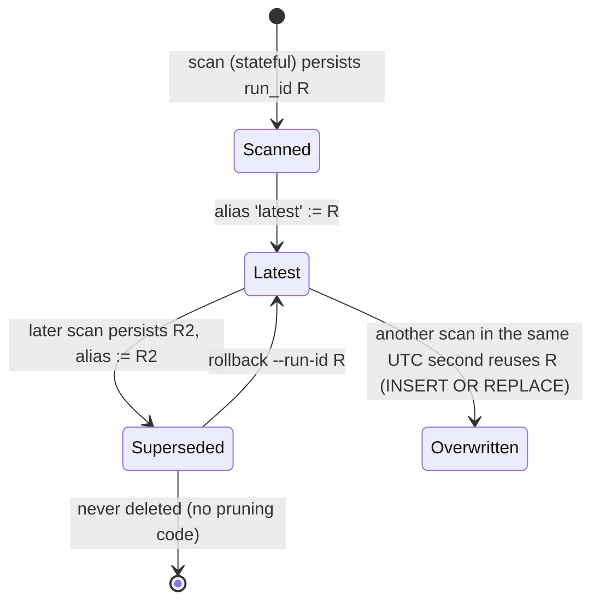

# Lifecycle

This page follows each tool from invocation to exit: what it creates, in what order, and what it leaves behind. For the internal call sequence, see [call-chains](../07-internals/call-chains.md). For the on-disk formats, see [state-and-persistence](state-and-persistence.md).

## Doctor invocation lifecycle

This section lists the phases of one `doctor` call, including the side effects that happen before any argument is checked.

| Phase | What happens | Source | Evidence |
|---|---|---|---|
| 1. Logging | `logging.basicConfig(handlers=[FileHandler("production_doctor.log")], force=True)`. Creates or opens the log in the **cwd** and removes every existing root handler. Level is DEBUG only if the literal string `--verbose` is in argv. | `src/somnus_debug/doctor/core.py:2179-2186` | [VERIFIED] [lane-a api-reference Example B](../_evidence/agent-findings/lane-a-arch-api/api-reference.md) |
| 2. Parse | `build_parser().parse_args(normalize_argv(argv))`. `--help` and usage errors raise `SystemExit` (0 or 2) here, after phase 1 has already created the log. | `:2187-2188`, `:2130-2176` | [VERIFIED] `/tmp/w1/help` (empty dir): `main(['--help'])` exits 0 via `SystemExit` and leaves a 0-byte `production_doctor.log` |
| 3. Configuration | `ConfigManager(-c path or None)`: load, merge onto defaults, validate, hash. No file discovery. | `:782-851` | [VERIFIED] [D-02](../DISCOVERY-LEDGER.md#d-02) |
| 4. State open | Unless `--no-state`: `StateStore.previous_file_index()` creates `<root>/<state_dir>/<reports_dir>/` and the SQLite schema, then reads the `latest` alias. On `StateStoreError`: warning on stderr, continue without state. | `:2064-2075`, `:1927-1953` | [VERIFIED] [lane-a architecture §3.4](../_evidence/agent-findings/lane-a-arch-api/architecture.md) run7 |
| 5. Discovery | `ProjectFileIndex` walks the tree at construction time; a missing or non-directory root raises `AnalysisExecutionError` (exit 4). With state enabled, phase 4 has already created a missing but writable root, so the scan sees an empty directory and exits 0 ([initialization](../07-internals/initialization.md#doctor-startup-sequence)). | `:926-982`, `:1930` | [VERIFIED] [lane-a api-reference §6](../_evidence/agent-findings/lane-a-arch-api/api-reference.md); `/tmp/w1` `scan ghost/root` exit 0 |
| 6. Analysis | Per-file analysis, graph, cycles, summary, state delta. Pure computation over the files read. | `:1705-1774` | [VERIFIED] `/tmp/w1/ex_api.py` |
| 7. Render | Markdown and JSON strings built in memory. | `:1783-1798`, `:578` | [VERIFIED] |
| 8. Write | Stateless: 2 atomic writes. Stateful: 6 atomic writes, then 3 `INSERT OR REPLACE` statements. | `:2082-2086`, `:1964-1979` | [VERIFIED] `/tmp/w1/ex_state.py` |
| 9. Exit | Prints the summary lines, returns `exit_code_for_summary(summary, severity_exit_level)`. | `:2087-2093`, `:2046-2058` | [VERIFIED] |

Errors raised in phases 3-8 go to `main`'s handlers. `DoctorError` produces exit 4. `OSError`, `RuntimeError`, `TypeError`, `ValueError`, and `sqlite3.Error` produce exit 5. Any other type escapes as a traceback. [SOURCE-CONFIRMED] `:2189-2199`. Writes are not transactional across artifacts: if `persist` fails at the database step, the six report files have already been written. [SOURCE-CONFIRMED] `:1966-1979`.

## Doctor subcommand side effects

This section states what each doctor subcommand leaves on disk, which differs more than the help text suggests.

| Subcommand | Creates | Where | Evidence |
|---|---|---|---|
| any, including `--help` | `production_doctor.log` (append) | cwd | [VERIFIED] [D-10](../DISCOVERY-LEDGER.md#d-10) |
| `scan --no-state` | `<basename>.md`, `<basename>.json` | `-o` / `--json-output`, else the scanned root | [VERIFIED] |
| `scan` | the above, plus `.python_doctor/state.sqlite3` (WAL), `reports/<run_id>/…`, `reports/latest.{md,json}` | scanned root | [VERIFIED] `/tmp/w1/ex_state.py` |
| `history` | `.python_doctor/` and an empty schema if absent | project root | [VERIFIED] [lane-a architecture §3.4](../_evidence/agent-findings/lane-a-arch-api/architecture.md) run8 |
| `rollback` | overwrites `reports/latest.{md,json}`, repoints the alias; does **not** touch the project-root report | project root | [VERIFIED] [D-09](../DISCOVERY-LEDGER.md#d-09) |
| `init-config` | `python_doctor.yaml` (or `-o`); refuses to overwrite without `--force` (exit 4) | cwd | [VERIFIED] |
| `self-check` | `self_check_report.{md,json}` plus state | the installed `somnus_debug/doctor/` directory | [VERIFIED] [lane-a architecture §3.6](../_evidence/agent-findings/lane-a-arch-api/architecture.md) |

## Run lifecycle in the state store

This section describes how one run's record is born, superseded, and possibly overwritten.

Runs are never pruned. The database and the `reports/<run_id>/` directories grow by one entry per distinct second. [SOURCE-CONFIRMED] no `DELETE` or `rmtree` in `src/somnus_debug/doctor/core.py`. Alias semantics: [state-transitions](../07-internals/state-transitions.md).

## structure lifecycle

This section covers the indexer's short life.

The indexer reads the source as UTF-8, builds the index in memory, and then writes to stdout or to `-o`/`--update-doc`. It creates parent directories and overwrites the target. Errors: `OSError` or `SyntaxError` print `error: …` and return 2. A `UnicodeDecodeError` from a non-UTF-8 file is not caught; it escapes as a traceback (exit 1). [SOURCE-CONFIRMED] `src/somnus_debug/structure/core.py:323-347`; [VERIFIED] latin-1 case in [lane-b configuration-findings §2.4](../_evidence/agent-findings/lane-b-config/configuration-findings.md).

## pycache-clean lifecycle

This section lists the cleaner's phases, which matter because one ordering quirk changes its logging.

1. Parse `sys.argv`; `--config` defaults to `config.yaml` in the cwd. A missing config file exits 1.
2. `CleanerConfig.from_yaml`: PyYAML `safe_load`, then `setattr` for known keys. An unknown key calls `logging.warning` here, before logging is configured. That implicitly configures the root logger at WARNING.
3. CLI overrides are applied, but only toward True or an int.
4. `setup_logging` calls `basicConfig` without `force`. If step 2 already configured the root logger, this is a no-op and INFO output is lost.
5. `PycacheCleaner(cfg)` runs `normalize()` (roots resolved against the cwd) and raises `ValueError` when no roots remain.
6. `run()`, then the summary log. Any exception is logged and exits 1.

[SOURCE-CONFIRMED] `src/somnus_debug/pycache_cleaner/core.py:170-186`, `:324-372`; [VERIFIED] step 2-4 interaction in [lane-b configuration-findings §1 item 8](../_evidence/agent-findings/lane-b-config/configuration-findings.md); [D-14](../DISCOVERY-LEDGER.md#d-14).

## init-test-harness lifecycle

This section covers the scaffold and the very different lifecycle of the file it writes.

`scaffold()` resolves the target. It refuses with `FileExistsError` before writing anything if any destination exists and `force` is false. Otherwise it creates the directory and writes each template. [SOURCE-CONFIRMED] `src/somnus_debug/test_harness/scaffold.py:62-88`. The scaffolded `run_test.py` has its own lifecycle when executed: one `test-runs/<RUN_ID>/` directory per run, holding `test.log`, `manifest.json`, and `report.md`, under `Path(__file__).parent.parent` unless `PROJECT_ROOT` is set. With the default target `.`, that is the repository's parent directory. [VERIFIED] [D-15](../DISCOVERY-LEDGER.md#d-15), [lane-f harness](../_evidence/agent-findings/lane-f-ext/harness.md).

## Sources

This section lists the code, evidence files, and probes this page rests on.

- `src/somnus_debug/doctor/core.py:782-851`, `:926-982`, `:1705-1798`, `:1916-2044`, `:2061-2199`
- `src/somnus_debug/structure/core.py:323-347`, `src/somnus_debug/pycache_cleaner/core.py:170-372`, `src/somnus_debug/test_harness/scaffold.py:62-125`
- [lane-a architecture.md](../_evidence/agent-findings/lane-a-arch-api/architecture.md), [lane-a api-reference.md](../_evidence/agent-findings/lane-a-arch-api/api-reference.md)
- [lane-b configuration-findings.md](../_evidence/agent-findings/lane-b-config/configuration-findings.md), [lane-f harness.md](../_evidence/agent-findings/lane-f-ext/harness.md)
- Executed probes: `/tmp/w1/ex_api.py`, `/tmp/w1/ex_state.py`, `/tmp/w1/cli`
