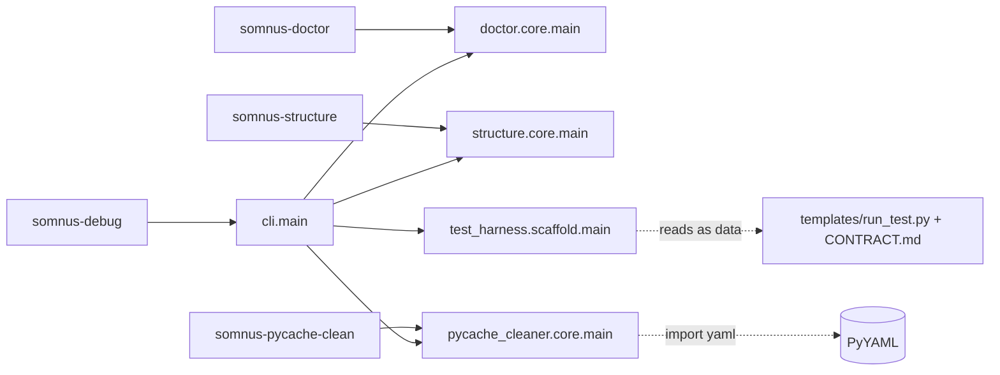

# System overview

`somnus-debug` 0.1.0 is a Python developer toolkit made of four independent tools behind one dispatcher. This page says what each tool is, how they relate, and which facts matter before you use them. Baseline: commit `034f46e`, Python 3.12.15.

## What the package contains

This section lists the four tools and the one module that joins them.

| Tool | Entry module | What it does | Runtime dependencies |
|---|---|---|---|
| `doctor` | `src/somnus_debug/doctor/core.py` (2203 lines) | AST-based production-readiness scan of a Python tree: syntax, imports, dependency cycles, stubs, placeholder returns, silent failures, docstring and type-hint coverage. Writes Markdown and JSON reports and keeps a local SQLite run history. | stdlib only |
| `structure` | `src/somnus_debug/structure/core.py` (351 lines) | Class and definition index of one Python file, rendered as Markdown. Never imports the target. | stdlib only |
| `pycache-clean` | `src/somnus_debug/pycache_cleaner/core.py` (375 lines) | Config-driven deletion of `__pycache__`, `*.pyc`, `*.pyo` across directory trees. | PyYAML (hard import) |
| `init-test-harness` | `src/somnus_debug/test_harness/scaffold.py` (129 lines) | Copies a single-test harness template (`run_test.py`, `CONTRACT.md`) into a target directory. | stdlib only |

`src/somnus_debug/cli.py` is a router. It reads the first argument, rewrites `sys.argv`, and calls the chosen tool's own `main()`. It defines no flags of its own beyond `-h/--help` and `-V/--version`. [SOURCE-CONFIRMED] `src/somnus_debug/cli.py:85-125`.

Line counts: [VERIFIED] `wc -l` over `src/`, see [file-index](../13-reference/file-index.md).

## How the tools relate

This section states the coupling between tools, which is close to none.

The tools share no code. Each `core.py` was moved from a standalone root script (`python_production_doctor.py`, `analyze_python_structure.py`, `pycache_cleaner.py`, `run_test.py`) and keeps its own argparse surface, logging setup, and exit-code conventions. [SOURCE-CONFIRMED] `src/somnus_debug/doctor/__init__.py`, `src/somnus_debug/structure/__init__.py`, `src/somnus_debug/pycache_cleaner/__init__.py` (docstrings: "moved verbatim").

The only coupling is in the dispatcher. `cli.py` imports all four tool modules at import time (`src/somnus_debug/cli.py:55-58`). Because `pycache_cleaner/core.py` raises on a missing PyYAML (`src/somnus_debug/pycache_cleaner/core.py:150-154`), every `somnus-debug` subcommand fails without PyYAML, doctor and structure included. The standalone `somnus-doctor` script does not have this problem. [VERIFIED] [lane-a architecture §1](../_evidence/agent-findings/lane-a-arch-api/architecture.md); see [D-13](../DISCOVERY-LEDGER.md#d-13).

There is no `somnus-init-test-harness` console script; the scaffold is reachable only through `somnus-debug init-test-harness` or the library function. [VERIFIED] `pyproject.toml` `[project.scripts]`; [lane-a architecture §1](../_evidence/agent-findings/lane-a-arch-api/architecture.md).

## Where the weight is

This section tells you which module carries the system, so you know where to read.

`doctor/core.py` holds 192 of the 256 inventoried symbols and nearly all behavior worth documenting: the configuration parser, file discovery, per-file AST analysis, import resolution, dependency graph, scoring, report rendering, and the SQLite state store. [VERIFIED] symbol counts from [symbols.tsv](../_evidence/agent-findings/lane-a-arch-api/symbols.tsv). The rest of this wiki's internals pages center on it: [architecture](architecture.md), [execution-model](execution-model.md), [call-chains](../07-internals/call-chains.md).

## Facts to know before relying on it

This section collects the behaviors most likely to surprise a first-time user; each links to its full treatment.

- Doctor never reads `python_doctor.yaml` on its own. Configuration applies only with `-c`. [VERIFIED] [D-02](../DISCOVERY-LEDGER.md#d-02).
- Every doctor `main()` call creates or appends `production_doctor.log` in the current directory and replaces the host process's root logging handlers (`logging.basicConfig(force=True)`, `src/somnus_debug/doctor/core.py:2179-2181`). [VERIFIED] [D-10](../DISCOVERY-LEDGER.md#d-10), [D-11](../DISCOVERY-LEDGER.md#d-11).
- The `structure` tool in `src/` crashes on every file carrying a `# somnus:metadata:v2` header, because `ast.parse(..., type_comments=True)` (`src/somnus_debug/structure/core.py:210`) treats header lines such as `#     type: "source-code"` as type comments. Two smoke tests fail for this reason. [VERIFIED] [D-01](../DISCOVERY-LEDGER.md#d-01).
- Doctor exit code 2 means either "critical findings" or "argparse usage error". [VERIFIED] [D-18](../DISCOVERY-LEDGER.md#d-18).
- There is no plugin or extension API. [VERIFIED] [D-19](../DISCOVERY-LEDGER.md#d-19).
- The clean embedding path is `ProjectScanner(root, ConfigManager(None)).scan({})`: it writes nothing and touches no logging. [VERIFIED] [D-12](../DISCOVERY-LEDGER.md#d-12); [public-api](../04-library-api/public-api.md).

## Where to go next

This section routes readers by intent.

- Structure and data flow: [architecture](architecture.md), [module-map](module-map.md).
- What runs when, and on which thread: [execution-model](execution-model.md), [lifecycle](lifecycle.md).
- What gets written to disk: [state-and-persistence](state-and-persistence.md).
- Calling it from Python: [04-library-api/overview](../04-library-api/overview.md).
- Rules the code holds (and where it breaks them): [design-invariants](design-invariants.md).

## Sources

This section lists the code, evidence files, and probes this page rests on.

- `src/somnus_debug/cli.py`, `src/somnus_debug/*/__init__.py`, `src/somnus_debug/doctor/core.py`, `src/somnus_debug/pycache_cleaner/core.py`, `src/somnus_debug/structure/core.py`, `pyproject.toml`
- [lane-a architecture.md](../_evidence/agent-findings/lane-a-arch-api/architecture.md)
- [lane-a symbols.tsv](../_evidence/agent-findings/lane-a-arch-api/symbols.tsv)
- [lane-d install-vs-source.md](../_evidence/agent-findings/lane-d-cli-tests/install-vs-source.md)
