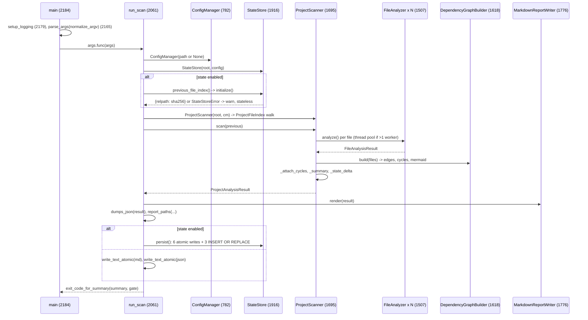

# Call chains

This page traces each command from its entry point to its last side effect, with line numbers, so a reader can follow the code or set breakpoints. All line numbers are at baseline `034f46e`. Unless noted, `core.py` means `src/somnus_debug/doctor/core.py`. Every chain on this page is [SOURCE-CONFIRMED] by reading the cited lines. Where a run confirmed behavior, it says so.

## Dispatcher chain

This section shows how `somnus-debug <cmd>` reaches a tool.

```
somnus-debug (console script) -> somnus_debug.cli:main           src/somnus_debug/cli.py:107
  argv = sys.argv[1:] if None
  [] | -h | --help        -> print(_TOP_LEVEL_HELP); return 0      :111-113
  -V | --version          -> print(__version__); return 0         :114-116
  unknown command         -> help to stderr; return 2              :119-122
  _run_subcommand(cmd, rest)                                       :85
    prog, entry = _SUBCOMMANDS[cmd]                                :60-65
    old = sys.argv; sys.argv = [prog, *rest]
    result = entry(list(rest))       # doctor / structure / init-test-harness
           | entry()                 # pycache-clean (reads sys.argv itself)   :100
    except SystemExit as e: return e.code if int else 1
    finally: sys.argv = old
    return result if int else 0
```

[VERIFIED] `sys.argv` restore and the return mapping: [lane-a api-reference §5](../_evidence/agent-findings/lane-a-arch-api/api-reference.md).

## doctor scan

This section is the full chain for the main command, with the scan pipeline as a sequence diagram.



Text form with lines:

```
run_scan(args)                                                      core.py:2061
  ConfigManager(Path(args.config).resolve() if args.config else None)  :2063 -> :785-790
    _load_raw :796-814 -> MinimalYamlParser.parse :653-668 | json.loads | defaults
    _validate :816-851 -> DoctorConfig
  StateStore(Path(args.project_root).resolve(), config)             :2065 -> :1919-1925
  previous = store.previous_file_index()  (unless --no-state)       :2068-2077 -> :1942-1953
  ProjectScanner(project_root, cm).scan(previous)                   :2078 -> :1698, :1705
    ProjectFileIndex(root, config)                                  :929 -> _discover :967, _modules :984
    run_id = utc_now_text()                                         :1708
    _analyze_files()                                                :1716-1732
    DependencyGraphBuilder(config).build(files)                     :1710 -> :1625-1632
    _attach_cycles(files, graph)                                    :1740-1755
    _summary(files, issues, graph)                                  :1764-1774
    _state_delta(files, previous)                                   :1757-1762
  MarkdownReportWriter(config).render(result)                       :2079 -> :1783-1798
  dumps_json(result)                                                :2080 -> :578
  store.report_paths(run_id, -o, --json-output)                     :2081 -> :1955-1962
  write_text_atomic x2 | store.persist(...)                         :2082-2086 -> :1964-1979
  print 3-5 summary lines                                           :2087-2092
  return exit_code_for_summary(summary, severity_exit_level)        :2093 -> :2046-2058
```

[VERIFIED] end-to-end through the library equivalent in `/tmp/w1/ex_state.py`, and through the CLI in `/tmp/w1/cli` (exit 2 on the fixture).

## Per-file analysis

This section expands `FileAnalyzer.analyze`, the origin of nearly every finding.

```
FileAnalyzer.analyze()                                              core.py:1520
  source = SourceReader().read(path)        tokenize.open           :1523 -> :1061-1067
    FileReadError -> _read_error(): one analysis_read_errors issue, metrics zeroed, return   :1524-1525, :1583-1586
  lines = source.splitlines()
  factory = DiagnosticIssueFactory(cm, relpath, lines)              :1527
  issues = _token_diagnostics(source, factory)                      :1528 -> :1548-1564
     todos per COMMENT token matching TODO_PATTERNS (first match only)
     tokenize.TokenError -> tokenization_errors
  tree = ast.parse(source, filename=str(path))                      :1530
     SyntaxError -> syntax_errors, _assemble(..., syntax_valid=False), return   :1531-1533
     ValueError  -> syntax_errors (e.g. null bytes), return                     :1534-1536
  records = ImportCollector().visit(tree)                           :1537-1539
  edges = [ImportResolver.resolve(path, r) for r in records]        :1540
  issues += _import_diagnostics(edges, tree, records, factory)      :1541 -> :1566-1581
  issues += CodeQualityVisitor(cm, factory).analyze(tree)           :1542-1544
  code_map = {module, docstring_present, imports, classes, functions}            :1545
  return _assemble(...)  stat, sha256, FileMetrics, dedupe_issues   :1546 -> :1588-1615
```

A file with a syntax error yields `todos` and possibly `tokenization_errors` plus `syntax_errors`, and nothing else. It gets no import edges, so it also drops out of the dependency graph. [VERIFIED] the fixture's `broken.py` yields both `syntax_errors` and `tokenization_errors` in `/tmp/w1/ex_api.py` (categories include both, 2 critical).

## Detector dispatch

This section maps every issue category to the line that emits it, the condition, and the switch that controls it.

| Category | Emitted at (`core.py`) | Reached from | Condition | Config switch |
|---|---|---|---|---|
| `analysis_read_errors` | 1585, 1737 | `_read_error`, `_execution_error` | read/decode failure; worker exception (threaded path only) | none |
| `syntax_errors` | 1532, 1535 | `analyze` | `ast.parse` raises | none |
| `tokenization_errors` | 1563 | `_token_diagnostics` | `tokenize.TokenError` | none |
| `todos` | 1559 | `_token_diagnostics` | comment matches `TODO_PATTERNS` (case-insensitive) | none |
| `missing_imports` | 1571 | `_import_diagnostics` | edge is `missing` or `unresolved_relative` | none |
| `unused_imports` | 1580 | `_import_diagnostics` | bound name never loaded as `ast.Name`; names starting `_` skipped | `detect_unused_imports` |
| `missing_docstrings` | 1170 / 1274 / 1284 | `visit_Module` / `_analyze_class` / `_analyze_function` | docstring shorter than `min_docstring_length` | `require_module/class/function_docstring` |
| `broad_exceptions` | 1218, 1221 | `visit_ExceptHandler` | bare `except`, or `Exception`/`BaseException` | none |
| `silent_failures` | 1223 | `visit_ExceptHandler` | `handler_is_silent` | `detect_silent_failures` |
| `security_risks` | 1230 | `visit_Call` | `dotted_name(func) in SECURITY_CALLS` | `detect_security_risks` |
| `stubs` | 1277 / 1288 | `_analyze_class` / `_analyze_function` | `body_is_stub` | none |
| `suspicious_short_classes` | 1279 | `_analyze_class` | `_short_class` (`:1297-1307`) | thresholds only |
| `type_hint_gaps` | 1286 | `_analyze_function` | `missing_type_hints` non-empty | `require_parameter_hints`, `require_return_hints` |
| `placeholder_returns` | 1291 | `_analyze_function` | `placeholder_return_kind` | none |
| `suspicious_short_functions` | 1293 | `_analyze_function` | executable lines < `min_function_lines` | threshold |
| `complexity` | 1295 | `_analyze_function` | complexity > `max_cyclomatic_complexity` (strict) | threshold |
| `duplicate_definitions` | 1321 | `_check_duplicates` | same name at more than one line in a scope | none |
| `incomplete_methods` | 1336 | `_check_abstracts` | same-file subclass missing a same-file abstract method | none |
| `dependency_cycles` | 1747 | `ProjectScanner._attach_cycles` | DFS cycle over local edges | `detect_dependency_cycles` (`:1631`) |
| `test_gaps` | none | none | never emitted | `detect_test_gaps` (dead) |

[SOURCE-CONFIRMED] emission lines from `grep -n 'create("'` over `core.py`. Behavior per category, including false positives: [lane-a architecture §3.3](../_evidence/agent-findings/lane-a-arch-api/architecture.md), [D-05](../DISCOVERY-LEDGER.md#d-05), [D-07](../DISCOVERY-LEDGER.md#d-07).

Visitor traversal gates (`_visit_function`, `src/somnus_debug/doctor/core.py:1233-1267`), in order:

1. A nested function is skipped entirely, body included, when `check_nested_functions` is false.
2. A name in `ignore_functions` is skipped entirely, body included ([D-16](../DISCOVERY-LEDGER.md#d-16)).
3. A private function is visited for its body (`generic_visit`), but it is not recorded, gets no function-level checks, and is not pushed onto the scope stack. Findings inside it are therefore attributed to the enclosing scope.

`ignore_classes` suppresses only the class-level checks. Methods are still analyzed (`:1271-1272`). [VERIFIED] [lane-f extensions](../_evidence/agent-findings/lane-f-ext/extensions.md).

## doctor history, rollback, init-config, self-check

This section gives the short chains for the remaining doctor subcommands.

```
run_history(args)                                                   core.py:2106
  ConfigManager(-c) -> StateStore(root, config).history(limit)       :2108 -> :1981-1989   (initialize() first)
  print(render_history(records))                                     :2034-2043
  return 0

run_rollback(args)                                                  core.py:2113
  ConfigManager(-c) -> StateStore(root, config).rollback(run_id)     :2115 -> :1991-2009
     SELECT run; check stored md/json exist; copy_file_atomic x2 -> reports/latest.*; INSERT OR REPLACE alias
  print 3 lines; return 0

run_init_config(args)                                               core.py:2096
  output = Path(-o or "python_doctor.yaml").resolve()   (relative to cwd)
  exists and not --force -> ConfigurationError (exit 4)
  write_text_atomic(output, ConfigManager.default_yaml()); return 0

run_self_check(args)                                                core.py:2123
  Namespace(project_root=<dir of core.py>, output=-o or <dir>/self_check_report.md, ...)
  return run_scan(namespace)
```

[VERIFIED] history and rollback through the library in `/tmp/w1/ex_state.py`. [VERIFIED] init-config and self-check in [lane-a architecture §3.5-3.6](../_evidence/agent-findings/lane-a-arch-api/architecture.md).

## structure

This section gives the indexer's chain.

```
structure.core.main(argv)                       src/somnus_debug/structure/core.py:323
  _parse_args(argv)                             :288-320   source, -o | --update-doc, --no-line-numbers, --source-label, --no-module-functions
  source = args.source.read_text("utf-8")       :326
  build_index(source, source_name=label or path, include_lines, include_module_functions)   :327-332
    ast.parse(source, filename, type_comments=True)          :210   <- D-01
    classes = top-level ClassDef; all_classes = ast.walk ClassDefs sorted by position
    scoped_classes = all_classes - those reachable via _iter_classes(tree.body)            :216-217
    occurrence labels for duplicate class names                                            :218-225
    _count_indexed_definitions([*classes, *scoped_classes], module_functions)              :231-233
    render: top-level classes (_render_class recursive) -> scoped classes -> module functions
  except (OSError, SyntaxError): print error, return 2
  write to -o/--update-doc (mkdir -p parent) or stdout; return 0
```

The double render ([D-24](../DISCOVERY-LEDGER.md#d-24)) comes from this chain. A class nested inside a function-scoped class is in `scoped_classes`, because `_iter_classes` only descends from module-level classes. Its parent is also in `scoped_classes`, and `_render_class` recurses into it. So it is rendered twice and counted twice. [VERIFIED] `/tmp/w1/ex_misc.py` (`LI` rendered twice).

## pycache-clean

This section gives the cleaner's chain.

```
pycache_cleaner.core.main()                     src/somnus_debug/pycache_cleaner/core.py:349
  parse_args() from sys.argv                    :337-346
  config_path missing -> stderr, sys.exit(1)    :351-354
  CleanerConfig.from_yaml(path)                 :170-180   yaml.safe_load; setattr known keys; logging.warning unknown
  CLI overrides (dry_run, verbose, max_depth, follow_symlinks)   :357-364
  setup_logging(cfg)                            :324-334   basicConfig (no force)
  PycacheCleaner(cfg)                           :192-205   normalize(); split targets; ValueError if no roots
  .run()                                        :207-218
    for root: missing -> logging.error, continue; else _scan_root(root)
    _scan_root: stack[(root, 0)]; scandir; depth check AFTER scandir;
                pass 1: excluded dirs skipped; target dirs -> _delete_directory
                pass 2: push non-target, non-excluded dirs at depth+1; matching files -> _delete_file
  any Exception -> logging.exception, sys.exit(1)   :370-372
```

`max_depth` is checked after `os.scandir`, so a directory beyond the limit is still listed, just not processed. [SOURCE-CONFIRMED] `:226-234`.

## init-test-harness

This section gives the scaffold's chain.

```
scaffold.main(argv)                             src/somnus_debug/test_harness/scaffold.py:112
  _parse_args: target (default "."), --force, --no-contract       :91-109
  scaffold(target, force, with_contract)                          :62-88
    destinations = [target/run_test.py (, target/CONTRACT.md)]
    not force and any exists -> FileExistsError (nothing written) -> main prints, return 1
    mkdir -p target; for each: write_text(_template_text(name))   :58-59 importlib.resources
  print "wrote <path>" lines and the next-step note; return 0
```

[VERIFIED] `/tmp/w1/ex_tools.py`, and [lane-a api-reference §4](../_evidence/agent-findings/lane-a-arch-api/api-reference.md).

## Sources

This section lists the code, evidence files, and probes this page rests on.

- `src/somnus_debug/cli.py:60-125`
- `src/somnus_debug/doctor/core.py:578`, `:653-668`, `:782-851`, `:926-1774`, `:1783-2127`, `:2165-2199`
- `src/somnus_debug/structure/core.py:127-347`, `src/somnus_debug/pycache_cleaner/core.py:170-372`, `src/somnus_debug/test_harness/scaffold.py:58-125`
- [lane-a architecture.md](../_evidence/agent-findings/lane-a-arch-api/architecture.md), [lane-a api-reference.md](../_evidence/agent-findings/lane-a-arch-api/api-reference.md), [lane-f extensions.md](../_evidence/agent-findings/lane-f-ext/extensions.md)
- Executed probes: `/tmp/w1/ex_api.py`, `/tmp/w1/ex_state.py`, `/tmp/w1/ex_misc.py`, `/tmp/w1/ex_tools.py`, `/tmp/w1/cli`
