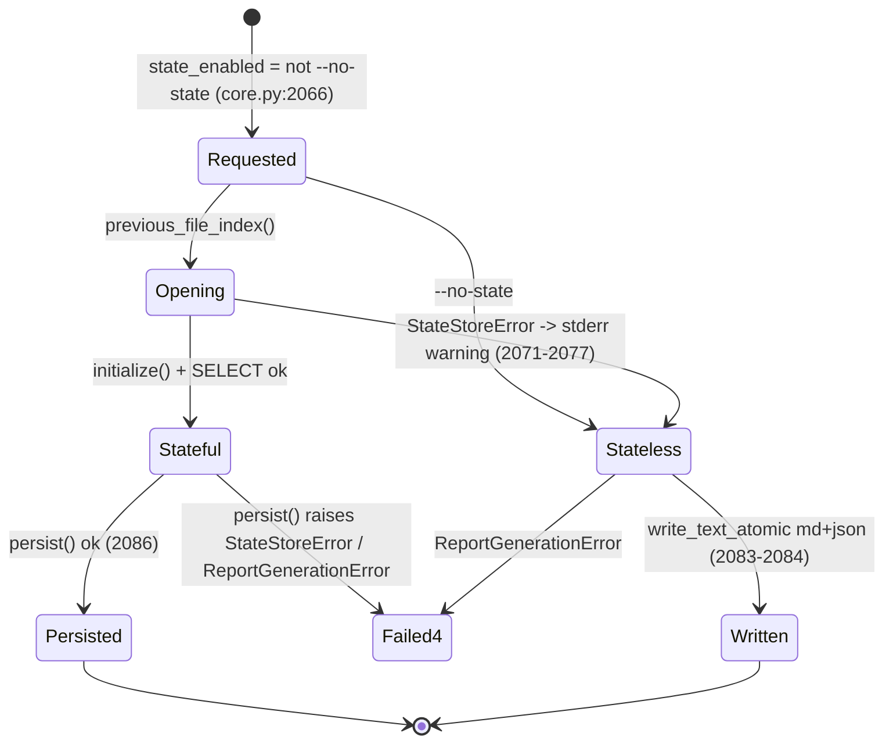
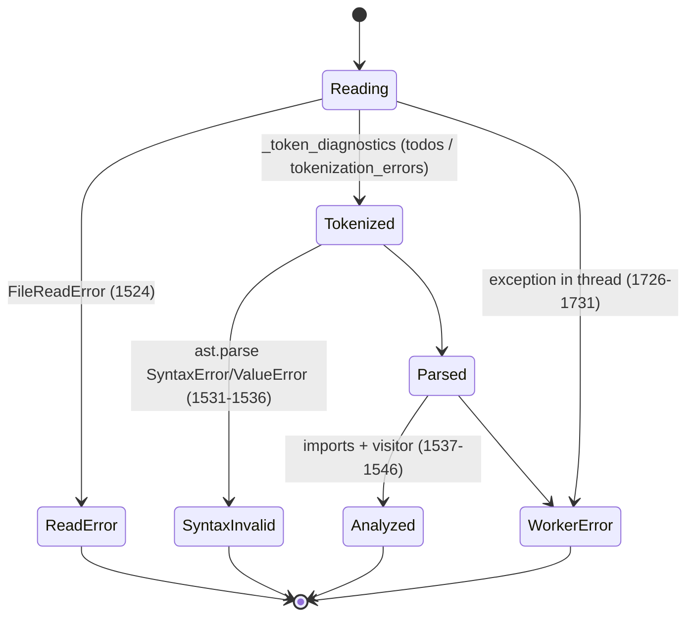
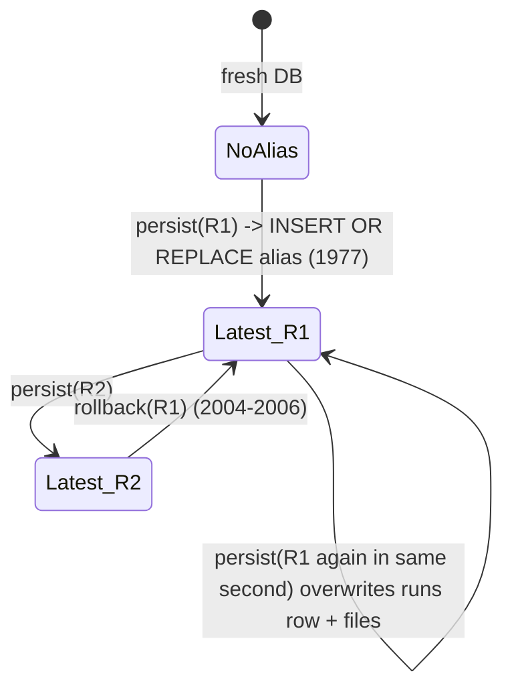

# State transitions

This page models the stateful parts of the toolkit as state machines: the doctor's state-enabled flag during a scan, each file's analysis outcome, the `latest` alias and run records, and the state delta between runs. Each machine is read from source and cites the line that causes each transition.

## Scan state mode

This section shows how a scan decides between stateful and stateless mode. The mode can change once, and only toward stateless.



There is no path from `Stateless` back to `Stateful`, and `history` and `rollback` have no `Stateless` branch: they exit 4 when the store cannot be opened. [SOURCE-CONFIRMED] `src/somnus_debug/doctor/core.py:2061-2093`, `:2106-2120`. [VERIFIED] the fallback with `.python_doctor` replaced by a regular file: scan exit 2 with reports, history exit 4 ([lane-a architecture §3.4](../_evidence/agent-findings/lane-a-arch-api/architecture.md) run7; [D-28](../DISCOVERY-LEDGER.md#d-28)).

## File analysis outcome

This section shows the states a single file can end in. The end state decides which checks ran and what the file contributes to the graph.



| End state | `syntax_valid` | `file_hash` | Issues | Import edges | In `StateDelta` |
|---|---|---|---|---|---|
| Analyzed | True | sha256 | all detectors | yes | yes |
| SyntaxInvalid | False | sha256 | todos, tokenization, syntax only | none | yes |
| ReadError | False | `""` | `analysis_read_errors` | none | **no**: empty hashes are skipped (`:1759`) |
| WorkerError (threaded path only) | False | `""` | `analysis_read_errors` with `<analysis>` symbol | none | **no** |

[SOURCE-CONFIRMED] `src/somnus_debug/doctor/core.py:1520-1546`, `:1583-1586`, `:1734-1738`, `:1757-1762`. A file that becomes unreadable between runs is therefore reported as **deleted** in the next delta. [HYPOTHESIS] Derived from the empty-hash rule; not run. On the serial path, a worker error is not a state at all: the scan aborts ([execution-model](../01-system/execution-model.md#doctor-the-serial-path-drops-the-error-wrapper)).

`SummaryCounts.syntax_error_files` counts every file with `syntax_valid=False`, so it includes read and worker errors as well as true syntax errors. [SOURCE-CONFIRMED] `:1773`.

## Run record and `latest` alias

This section models the alias that `previous_file_index`, `rollback`, and the `latest.*` files share.



| Event | `runs` | `file_snapshots` | alias `latest` | `reports/latest.*` | project-root report |
|---|---|---|---|---|---|
| `persist(R)`, new second | +1 row | +N rows | → R | overwritten with R | overwritten with R |
| `persist(R)`, same second as an earlier R | row replaced | rows replaced (stale paths from the earlier run remain if files were removed) | → R | overwritten | overwritten |
| `rollback(R_old)` | unchanged | unchanged | → R_old | copied from R_old's stored files | **unchanged** |
| `history` | read | not read | not read | untouched | untouched |

[SOURCE-CONFIRMED] `src/somnus_debug/doctor/core.py:1964-2009`. [VERIFIED] the alias moves on rollback (`/tmp/w1/ex_state.py`: `alias now ('20261112T004654Z',)`). [VERIFIED] the project-root report is untouched by rollback ([D-09](../DISCOVERY-LEDGER.md#d-09)), and same-second replacement happens ([D-08](../DISCOVERY-LEDGER.md#d-08)). The stale-snapshot row case follows from `INSERT OR REPLACE` with a composite key and no prior `DELETE`. [SOURCE-CONFIRMED]; not run.

After a rollback, the next scan diffs against the rolled-back run, because `previous_file_index` follows the alias. [VERIFIED] [lane-f compositions C3g](../_evidence/agent-findings/lane-f-ext/compositions.md).

## State delta classification

This section defines how each file is classified between two runs.

Given `previous = {path: hash}` (from the alias) and `current = {path: hash for files with a non-empty hash}`:

| Class | Rule |
|---|---|
| `new_files` | in current, not in previous |
| `modified_files` | in both, hash differs |
| `deleted_files` | in previous, not in current |
| `unchanged_files` | in both, hash equal |

[SOURCE-CONFIRMED] `src/somnus_debug/doctor/core.py:1757-1762`. [VERIFIED] `/tmp/w1/ex_state.py`: run 0 has 6 new; run 1 has 0 new and 6 unchanged. Paths are relative to the project root. Changing `include_patterns` or `ignore_patterns` between runs therefore shows files as new or deleted, and `config_hash` is never compared to warn about it ([D-21](../DISCOVERY-LEDGER.md#d-21) covers the same blind spot in `delta.py`).

## Configuration load states

This section lists the outcomes of `ConfigManager.__init__`.

```
None            -> Defaults            (DEFAULT_CONFIG_DATA merged with {})
path missing    -> ConfigurationError
.json           -> json.loads -> object? -> merge -> validate -> Valid | ConfigurationError
.yaml/.yml      -> MinimalYamlParser -> mapping? -> merge -> validate -> Valid | ConfigurationError
other suffix    -> ConfigurationError
```

A file that parses but mis-parses silently (unknown keys, quoted keys, the [D-04](../DISCOVERY-LEDGER.md#d-04) forms) still reaches `Valid` with defaults where its keys did not land. [SOURCE-CONFIRMED] `:796-851`; [VERIFIED] [lane-b configuration-findings §3](../_evidence/agent-findings/lane-b-config/configuration-findings.md).

## Pycache entry states

This section gives the per-directory-entry decision in `_scan_root`.

| Entry | Excluded name? | Target dir name? | Matches file pattern? | Outcome |
|---|---|---|---|---|
| dir | yes | any | n/a | skipped, not descended |
| dir | no | yes | n/a | `_delete_directory` (counted even in dry run), not descended |
| dir | no | no | n/a | pushed at `depth+1` |
| file | n/a | n/a | yes (case-sensitive) | `_delete_file` (counted even in dry run) |
| file | n/a | n/a | no | left |

A directory at `depth > max_depth` is listed but not processed. A failed delete logs a warning and is not counted. [SOURCE-CONFIRMED] `src/somnus_debug/pycache_cleaner/core.py:220-308`. [VERIFIED] case sensitivity and dry-run counting in `/tmp/w1/ex_tools.py`.

## Sources

This section lists the code, evidence files, and probes this page rests on.

- `src/somnus_debug/doctor/core.py:796-851`, `:1520-1546`, `:1583-1586`, `:1734-1773`, `:1942-2009`, `:2061-2120`
- `src/somnus_debug/pycache_cleaner/core.py:220-308`
- [lane-a architecture.md §3.4](../_evidence/agent-findings/lane-a-arch-api/architecture.md), [lane-b configuration-findings.md](../_evidence/agent-findings/lane-b-config/configuration-findings.md), [lane-f compositions.md](../_evidence/agent-findings/lane-f-ext/compositions.md)
- Executed probes: `/tmp/w1/ex_state.py`, `/tmp/w1/ex_tools.py`
